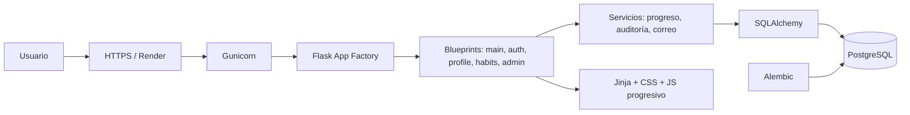

# Documento Maestro Técnico — VitaliLab

| Campo | Valor |
|---|---|
| Producto | VitaliLab |
| Tipo | Aplicación web educativa de hábitos saludables |
| Arquitectura | Monolito modular Flask + Jinja + SQLAlchemy |
| Datos compartidos | PostgreSQL 18 |
| Datos locales/pruebas | SQLite permitido |
| Repositorio | Privado: `juandigira17111980/vitalilab-profesional` |
| Rama de trabajo | `feat/reconstruccion-profesional` |
| Fecha de corte | 30 de septiembre de 2026 |
| Production | Congelada hasta aprobación explícita |

## 1. Propósito y alcance

VitaliLab convierte acciones cotidianas en un registro comprensible de hábitos, puntos y constancia. Incluye registro y acceso, perfil, medidas opcionales, IMC educativo, hábitos, dashboard, contenidos y comunicados administrativos.

No es un sistema clínico, no diagnostica y no reemplaza orientación profesional. La primera entrega profesional prioriza seguridad, integridad, claridad y facilidad de sustentación sobre complejidad innecesaria.

## 2. Transformación realizada

| Área | Prototipo auditado | Solución reconstruida | Evidencia |
|---|---|---|---|
| Arquitectura | Archivo Flask central y responsabilidades mezcladas | Fábrica de aplicación y blueprints por dominio | `app/` y pruebas de renderizado |
| Datos | SQLite y entidad mezclada | 7 tablas relacionales, constraints, índices y 2 migraciones | `migrations/versions/` + `db check` |
| Contraseñas | Tratamiento inseguro | Hash scrypt con Werkzeug | Pruebas de registro y acceso |
| Hábitos | Riesgo de puntos duplicados | Evento único usuario+hábito+fecha y servicio idempotente | `uq_habit_daily` + prueba de doble envío |
| Frontend | Vistas inconsistentes | Layout compartido, sistema visual, responsive y estados | Capturas Playwright |
| Seguridad | Secreto en código y controles incompletos | Variables externas, CSRF, RBAC, rate limits y cabeceras | Suite y revisión de respuestas |
| Entrega | Sin CI ni health checks | CI, Docker, Compose, Blueprint, `/health` y `/ready` | Archivos de infraestructura |

## 3. Arquitectura vigente

La aplicación es un monolito modular porque el alcance académico no justifica microservicios. El modelo reduce operación, mantiene una sola transacción y permite separar responsabilidades con bajo costo.

## 4. Decisiones registradas

| ID | Decisión | Razón | Estado |
|---|---|---|---|
| ADR-001 | Mantener Flask | Reduce riesgo de reescritura y aprovecha el prototipo | ✅ |
| ADR-002 | Monolito modular | Suficiente separación sin complejidad distribuida | ✅ |
| ADR-003 | PostgreSQL en ambientes compartidos | Persistencia, concurrencia e integridad | ✅ Configurado; 🟡 Staging remoto |
| ADR-004 | Alembic/Flask-Migrate | Esquema reproducible y trazable | ✅ |
| ADR-005 | Puntos derivados de eventos | Evita saldos manipulables y datos duplicados | ✅ |
| ADR-006 | Sesiones de servidor firmadas | Adecuado para aplicación Jinja y menor superficie que JWT | ✅ |
| ADR-007 | Local → Staging → Production | Aísla riesgo y exige evidencia | ✅ Proceso; 🟡 despliegue Staging |

## 5. Reglas de negocio

1. El correo se normaliza y es único.
2. La contraseña exige 10 caracteres, mayúscula, minúscula y número; solo se guarda el hash.
3. Cinco fallos bloquean temporalmente la cuenta durante 15 minutos.
4. La recuperación no revela si el correo existe y el token se invalida al cambiar la contraseña.
5. Cada hábito puede completarse una vez por usuario y día.
6. Los puntos se calculan desde `habit_entries`; el navegador no envía el puntaje.
7. La racha cuenta días consecutivos con al menos un cumplimiento; permite que el último día registrado sea ayer.
8. Solo `admin` crea, publica o archiva comunicados.
9. Las medidas son opcionales, pertenecen al usuario y no aparecen en auditoría.
10. El IMC se presenta como orientación educativa, no diagnóstico.

## 6. Ambientes

| Ambiente | Rama | Base | Datos | Estado |
|---|---|---|---|---|
| Local | feature/fix | SQLite o PostgreSQL local | Sintéticos | ✅ verificado |
| Staging | `staging` | PostgreSQL exclusivo | Sintéticos | 🟡 definición lista, despliegue pendiente |
| Production | `main`/release aprobada | PostgreSQL exclusivo antes de migrar | Reales | 🔴 no modificar todavía |

El servicio histórico de Production no comparte base, variables ni dominio con Staging.

## 7. Calidad y evidencia

- 24 pruebas automatizadas aprobadas.
- Cobertura total: 90,41 %, por encima del umbral obligatorio de 85 %.
- Ruff: sin errores de formato ni análisis.
- Migraciones: upgrade desde base vacía y `db check` aprobados en SQLite local.
- Navegador: registro, login/logout, dashboard, hábito, menú móvil, administración y comunicados aprobados.
- Consola del navegador: 0 errores y 0 advertencias en el flujo final.
- Hallazgos detectados y corregidos durante E2E: incompatibilidad de expiración CSRF y validación débil del CLI administrativo.

## 8. Riesgos y límites restantes

| Riesgo | Estado | Control requerido |
|---|---|---|
| CI aún no ejecutado sobre el commit final | 🟡 | Abrir PR y exigir tres jobs verdes |
| Staging aún sin URL funcional | 🟡 | Crear Blueprint, completar variables y smoke tests |
| PostgreSQL no validado localmente por falta de Docker | 🟡 | Job `postgres-migration` en CI |
| SMTP no configurado | 🟡 | Registrar proveedor/secretos en Staging |
| Backup/restauración no ensayados | 🔴 Production | Base persistente y simulacro documentado |
| Política institucional para salud/menores | 🔴 Production | Revisión del responsable de tratamiento |

## 9. Definición de terminado

Una fase se cierra cuando el código, migración, pruebas, evidencia visual, documentación y procedimiento de rollback coinciden. La release de Production requiere además CI verde, Staging aprobado, backup/restauración, SMTP funcional y autorización explícita.

## 10. Documentos dependientes

- [Modelo DBA](03_MODELO_DE_DATOS_DBA.md)
- [Seguridad y privacidad](06_SEGURIDAD_Y_PRIVACIDAD.md)
- [Infraestructura y Render](08_INFRAESTRUCTURA_Y_DEPLOY_RENDER.md)
- [Informe QA y readiness](13_INFORME_QA_Y_READINESS.md)
