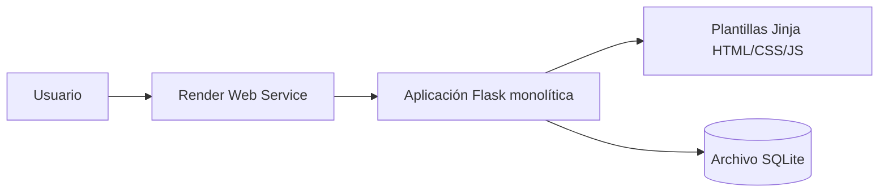
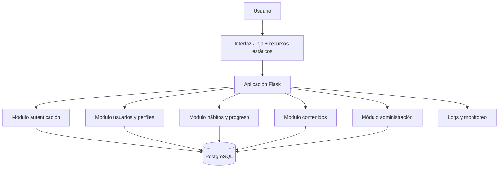
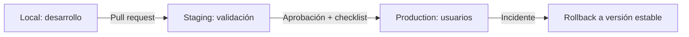

# Documento Maestro Técnico — VitaliLab

| Campo | Valor |
|---|---|
| Proyecto | VitaliLab |
| Tipo | Aplicación web educativa de hábitos saludables |
| Estado | Auditoría y profesionalización en curso |
| Repositorio de trabajo | Privado: `juandigira17111980/vitalilab-profesional` |
| Producción observable | Render, servicio `vitalilab` |
| Fecha de corte | 30 de septiembre de 2026 |
| Regla de producción | No modificar hasta aprobación explícita |

## 1. Propósito

VitaliLab busca apoyar a sus usuarios en la adopción de hábitos saludables mediante registro, perfil, retos diarios, contenidos y una experiencia sencilla. Este documento es la fuente central de verdad técnica para el desarrollo y la sustentación académica.

No sustituye los documentos especializados; los conecta y establece qué está vigente, qué está propuesto y cómo se demuestra cada avance.

## 2. Alcance funcional observado

En la versión de producción revisada se identificaron estas capacidades:

- Registro e inicio de sesión.
- Perfil con datos personales y medidas corporales.
- Cálculo o presentación del índice de masa corporal (IMC).
- Puntos, racha, nivel y retos diarios.
- Páginas informativas sobre nutrición, ejercicio y bienestar.

La revisión no confirma todavía todos los flujos con datos reales de producción. El análisis funcional definitivo deberá repetirse en Staging con usuarios de prueba.

## 3. Estado ejecutivo

| Área | Estado actual | Estado objetivo | Situación |
|---|---|---|---|
| Datos | SQLite y una tabla principal mezclando responsabilidades | PostgreSQL normalizado, migraciones y copias de seguridad | 🔴 Requiere rediseño |
| Backend | Flask monolítico, SQL directo y reglas acopladas | Monolito modular Flask con servicios, ORM y pruebas | 🔴 Requiere refactorización |
| Frontend | Plantillas Jinja con estilos y scripts repetidos | Sistema visual consistente, responsive y accesible | 🟡 Diseño pendiente |
| Seguridad | Se detectaron contraseña y secreto inseguros en la versión activa | Hash seguro, secretos externos, CSRF, límites y cabeceras | 🔴 Prioridad crítica |
| Git | Repositorio privado y estrategia base creados | Pull requests, revisión, CI y releases trazables | 🟡 Parcial |
| Infraestructura | Production organizado; Staging vacío | Tres ambientes reproducibles con health check y rollback | 🟡 Parcial |
| QA | No se encontraron pruebas automatizadas | Pirámide de pruebas y evidencia de aceptación | 🔴 Pendiente |

## 4. Arquitectura actual verificada

Características observadas:

- Aplicación concentrada principalmente en archivos Python de nivel raíz.
- Acceso directo mediante `sqlite3` en la versión activa.
- Autenticación, perfil y gamificación unidos a una misma entidad.
- Plantillas con CSS/JavaScript embebido y navegación repetida.
- Ausencia de migraciones, pruebas, health check y proceso WSGI verificable en la versión activa.

## 5. Arquitectura objetivo propuesta

Se propone un **monolito modular**, suficiente para el alcance académico y más fácil de operar que microservicios.

Principios:

- Separación entre presentación, reglas de negocio y persistencia.
- Una sola definición del modelo de datos, controlada por migraciones.
- Configuración por ambiente, sin secretos en Git.
- Reglas de negocio probables mediante pruebas unitarias.
- Despliegue primero en Staging y promoción controlada.

## 6. Módulos propuestos

| Módulo | Responsabilidad | Entidades principales |
|---|---|---|
| `auth` | Registro, acceso, cierre de sesión y recuperación | `users`, sesiones/tokens |
| `users` | Perfil, preferencias y medidas | `user_profiles`, `health_measurements` |
| `habits` | Catálogo, cumplimiento diario, puntos y rachas | `habits`, `habit_entries`, `daily_checkins` |
| `content` | Contenido educativo y anuncios | `content_items`, `announcements` |
| `admin` | Gestión autorizada y auditoría | `audit_events` |
| `shared` | Errores, validación, utilidades y políticas transversales | No aplica |

Los nombres definitivos se validarán durante el diseño detallado. No deben crearse tablas innecesarias solo para aparentar complejidad.

## 7. Decisiones de arquitectura

| ID | Decisión | Motivo | Estado |
|---|---|---|---|
| ADR-001 | Mantener Flask como framework inicial | Reduce riesgo y aprovecha el conocimiento existente | 🟡 Propuesto |
| ADR-002 | Adoptar monolito modular | Separa responsabilidades sin costo operativo de microservicios | 🟡 Propuesto |
| ADR-003 | Usar PostgreSQL en ambientes compartidos | Concurrencia, integridad, operación y copias más robustas | 🟡 Propuesto |
| ADR-004 | Gestionar esquema con migraciones | Evita scripts destructivos y deriva entre ambientes | 🟡 Propuesto |
| ADR-005 | Separar Local, Staging y Production | Permite validar sin afectar usuarios reales | ✅ Estructura de ambientes creada; Staging aún sin servicio |
| ADR-006 | Proteger Production por proceso mientras no haya función de plan | El plan actual de Render no permite activar protección avanzada | ✅ Regla operativa documentada |

## 8. Reglas de negocio objetivo

1. El correo o identificador de acceso debe ser único y normalizado.
2. La contraseña nunca se almacena en texto legible.
3. Un usuario solo puede registrar una vez el mismo hábito por fecha, salvo regla explícita.
4. Los puntos deben derivarse de eventos verificables, no de parámetros enviados por el navegador.
5. La racha aumenta solo con días consecutivos válidos y no con múltiples clics del mismo día.
6. Los cambios de rol o estado administrativo deben quedar auditados.
7. Las medidas de salud son datos sensibles: se minimizan, protegen y eliminan según una política definida.
8. El IMC es un indicador educativo; la aplicación no debe presentarlo como diagnóstico médico.

## 9. Ambientes y flujo de promoción

| Ambiente | Propósito | Rama sugerida | Datos |
|---|---|---|---|
| Local | Desarrollo y pruebas rápidas | Rama de funcionalidad | Sintéticos |
| Staging | Integración, QA y demostración | `staging` | Sintéticos; nunca copia sin anonimizar |
| Production | Servicio vigente | `main`/release aprobada | Reales y protegidos |

## 10. Estándares mínimos de implementación

- Código formateado y revisado.
- Configuración externa mediante variables de entorno.
- Migraciones reversibles o con procedimiento de recuperación.
- Pruebas unitarias, integración y recorrido crítico.
- Logs sin contraseñas, tokens ni datos médicos.
- Rutas con autorización explícita.
- Formularios con CSRF, validación del servidor y mensajes comprensibles.
- Componentes visuales reutilizables y navegación responsive.
- Documentación y bitácora actualizadas en el mismo pull request.

## 11. Riesgos prioritarios

| Riesgo | Probabilidad | Impacto | Tratamiento |
|---|---:|---:|---|
| Exposición de contraseñas por almacenamiento inseguro | Alta | Crítico | Migración obligatoria a hash seguro y reinicio de credenciales si aplica |
| Pérdida de datos por script destructivo o disco efímero | Alta | Crítico | PostgreSQL, migraciones, backup y prueba de restauración |
| Despliegue incompatible por divergencia entre código y plantillas | Alta | Alto | Baseline estable, contratos y pruebas de integración |
| Manipulación de puntos y rachas | Alta | Alto | Reglas en servidor, restricciones únicas y transacciones |
| Tratamiento inadecuado de datos de salud o menores | Media/Alta | Crítico | Minimización, consentimiento, privacidad y revisión jurídica aplicable |
| Cambios directos a producción | Media | Alto | Flujo obligatorio Local → Staging → Production y rollback |

## 12. Roadmap técnico

### Fase 0 — Preservar y reproducir

- Congelar referencia de producción y documentar configuración sin revelar secretos.
- Recuperar un baseline que ejecute localmente.
- Levantar Staging sin dominio ni base de datos de Production.

### Fase 1 — Seguridad y datos

- Corregir secretos y contraseñas.
- Diseñar modelo normalizado y migraciones.
- Implantar PostgreSQL, backup y restauración probada.

### Fase 2 — Backend

- Crear fábrica de aplicación, configuración por ambiente y módulos.
- Separar repositorios/servicios/rutas.
- Corregir reglas de puntos, rachas y autorización.

### Fase 3 — Frontend

- Crear layout y componentes.
- Mejorar formularios, responsive, accesibilidad y estados de error.
- Validar experiencia con usuarios de prueba.

### Fase 4 — Calidad e infraestructura

- Automatizar pruebas y validaciones.
- Añadir health check, observabilidad, despliegue controlado y rollback.
- Ejecutar auditoría final y preparar sustentación.

## 13. Matriz de trazabilidad

| Requisito | Diseño | Evidencia esperada | Estado |
|---|---|---|---|
| Autenticación segura | `auth` + hash + sesión | Pruebas de registro/login/logout y revisión de DB | 🟡 |
| Un reto diario por usuario | Restricción única + servicio | Prueba de doble envío e integridad de puntos | 🟡 |
| Datos normalizados | Modelo DBA | Migraciones y diagrama contra esquema real | 🟡 |
| Interfaz móvil | Componentes responsive | Capturas y pruebas en anchos definidos | 🟡 |
| Despliegue seguro | Tres ambientes | Build, health check y rollback documentado | 🟡 Parcial |
| Trazabilidad académica | Git + bitácora | Issue/PR/commit/prueba por cambio | ✅ Base creada |

## 14. Definición de terminado

Una mejora solo está terminada cuando:

1. El código o configuración está versionado.
2. Tiene prueba proporcional al riesgo.
3. Fue desplegada y validada en Staging.
4. No expone secretos ni datos personales.
5. La documentación y bitácora fueron actualizadas.
6. Cuenta con aprobación antes de Production.

## 15. Referencias relacionadas

- [Auditoría profunda](AUDITORIA_PROFUNDA_Y_PLAN_DE_MEJORA.md)
- [Modelo de datos](03_MODELO_DE_DATOS_DBA.md)
- [Seguridad y privacidad](06_SEGURIDAD_Y_PRIVACIDAD.md)
- [Infraestructura y despliegue](08_INFRAESTRUCTURA_Y_DEPLOY_RENDER.md)
- [Bitácora verificable](11_BITACORA_DE_CAMBIOS.md)
