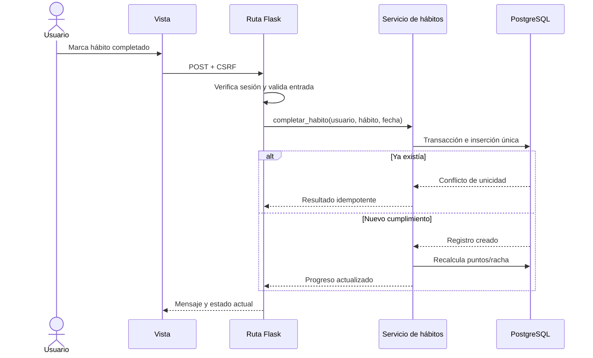

# Arquitectura y estructura del proyecto

## 1. Objetivo

Definir cómo se organiza VitaliLab, qué responsabilidad tiene cada parte y cómo evoluciona desde el prototipo actual hacia una solución profesional que siga siendo comprensible para un equipo estudiantil.

## 2. Estructura actual observada

La revisión del código histórico muestra una aplicación Flask con archivos Python de nivel raíz y plantillas Jinja. La lógica web, las consultas SQL y las reglas del dominio están fuertemente acopladas.

```text
vitalilab/
├── vida_saludable.py       # aplicación activa histórica y rutas
├── crear_db.py             # creación destructiva de tabla
├── templates/              # vistas HTML con estilos/scripts embebidos
├── static/                 # recursos parciales
└── *.db                    # SQLite versionado o referenciado
```

Problemas arquitectónicos:

- Un cambio en datos puede romper rutas y plantillas simultáneamente.
- No existe una frontera clara entre autenticación, perfil y gamificación.
- El esquema puede alterarse mediante scripts sin historial de migración.
- La configuración depende del código y no de cada ambiente.
- El arranque, la observabilidad y las pruebas no tienen contratos definidos.

## 3. Estructura objetivo propuesta

```text
vitalilab-profesional/
├── app/
│   ├── __init__.py              # fábrica create_app
│   ├── config.py                # Local/Staging/Production
│   ├── extensions.py            # DB, migraciones, login, CSRF, limiter
│   ├── auth/
│   │   ├── routes.py
│   │   ├── services.py
│   │   ├── forms.py
│   │   └── models.py
│   ├── users/
│   ├── habits/
│   ├── content/
│   ├── admin/
│   ├── shared/
│   │   ├── errors.py
│   │   ├── validators.py
│   │   └── security.py
│   ├── templates/
│   │   ├── layouts/base.html
│   │   ├── components/
│   │   └── pages/
│   └── static/
│       ├── css/
│       ├── js/
│       └── img/
├── migrations/
├── tests/
│   ├── unit/
│   ├── integration/
│   └── e2e/
├── docs/
├── .github/workflows/
├── .env.example
├── requirements.txt
├── wsgi.py
└── README.md
```

Esta es una estructura de referencia. Puede ajustarse durante la implementación, pero toda variación debe documentar el motivo.

## 4. Responsabilidades por capa

| Capa | Puede hacer | No debe hacer |
|---|---|---|
| Rutas/controladores | Recibir petición, invocar servicio y responder | Ejecutar reglas complejas o SQL directo |
| Servicios | Aplicar reglas de negocio y transacciones | Renderizar HTML o leer variables del navegador directamente |
| Repositorios/ORM | Consultar y persistir entidades | Decidir puntos, roles o permisos de negocio |
| Formularios/esquemas | Validar forma, tipo y formato de entrada | Autorizar al usuario |
| Plantillas | Presentar datos ya preparados | Consultar DB o calcular reglas críticas |
| Configuración | Elegir comportamiento por ambiente | Contener secretos reales versionados |

## 5. Flujo de una operación crítica

Ejemplo: completar un hábito.



## 6. Contratos técnicos esenciales

- `create_app(config_name)` crea una aplicación sin efectos destructivos.
- `GET /health` comprueba que el proceso responde; una verificación de DB puede exponerse por separado y protegerse.
- Los formularios `POST` requieren sesión cuando corresponde, token CSRF y validación de servidor.
- Las operaciones repetibles son idempotentes o están protegidas por restricciones.
- Los errores se convierten en respuestas controladas y se registran con un identificador de correlación.
- Ninguna plantilla depende de variables no declaradas en su contrato de vista.

## 7. Configuración por ambiente

| Configuración | Local | Staging | Production |
|---|---|---|---|
| Debug | Opcional | Desactivado | Desactivado |
| Base de datos | Local/dedicada | PostgreSQL Staging | PostgreSQL Production |
| Cookies seguras | Simulables | Activadas | Activadas |
| Logs | Detallados sin secretos | Estructurados | Estructurados y retenidos |
| Datos | Sintéticos | Sintéticos | Reales |

## 8. Criterios de aceptación arquitectónica

- Importar la aplicación no crea ni elimina tablas.
- Todos los módulos arrancan con una configuración de prueba.
- Las dependencias tienen versiones controladas y son mínimas.
- Las rutas críticas cuentan con pruebas de autorización y errores.
- El esquema se crea desde migraciones sobre una base vacía.
- El frontend reutiliza un layout común y no duplica navegación.
- La aplicación puede desplegarse en Staging sin cambiar archivos de código.

## 9. Estado

La estructura objetivo está **🟡 propuesta**. No se debe presentar como implementada hasta que los archivos, pruebas y despliegue aparezcan en la [bitácora](11_BITACORA_DE_CAMBIOS.md).
