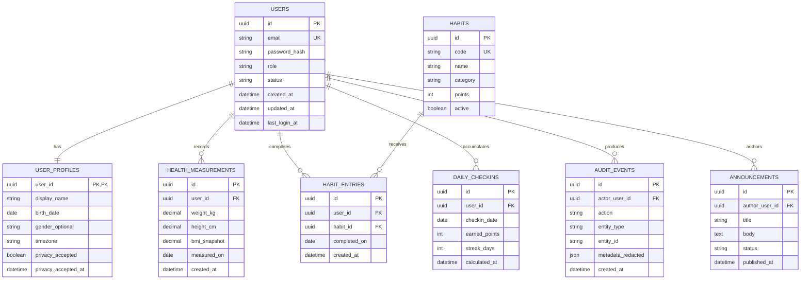

# Modelo de datos y guía DBA

## 1. Diagnóstico del estado actual

La versión activa revisada utiliza SQLite y concentra en `usuarios` datos de acceso, identidad, medidas de salud y gamificación. También se encontró un script de creación que puede eliminar la tabla y cuyo esquema no coincide completamente con el consumido por la aplicación.

Hallazgos principales:

- 🔴 Contraseñas tratadas en texto legible.
- 🔴 Script con `DROP TABLE IF EXISTS`, peligroso fuera de una base desechable.
- 🔴 Falta de migraciones versionadas.
- 🔴 Falta de restricciones que impidan sumar varias veces el mismo reto diario.
- 🔴 SQLite no es una base adecuada para una aplicación compartida en Render si el almacenamiento es efímero o hay concurrencia.
- 🟡 Archivo histórico inspeccionado sin filas de usuarios; no confirma el contenido real del entorno de producción.

## 2. Principios del nuevo modelo

1. Separar credenciales, perfil, medidas y progreso.
2. Aplicar integridad con claves foráneas, restricciones únicas y validaciones.
3. Mantener historial cuando el dato cambia en el tiempo.
4. Minimizar datos personales y sensibles.
5. Ejecutar todo cambio mediante migraciones.
6. Permitir respaldo y restauración probada.

## 3. Modelo lógico propuesto



> El modelo es **🟡 propuesto**. Antes de crear la primera migración se debe validar el alcance funcional y la necesidad real de cada atributo.

## 4. Diccionario de entidades

### `users`

Cuenta y control de acceso. El correo se almacena normalizado. `password_hash` usa un algoritmo mantenido por una biblioteca reconocida. `role` inicia con `student`/`admin` o nombres de negocio acordados; `status` permite desactivar sin borrar.

Restricciones recomendadas:

- `email` único y no nulo.
- `password_hash` no nulo.
- `role` y `status` con valores controlados.
- Índice por `status` solo si los planes de ejecución lo justifican.

### `user_profiles`

Información de presentación y preferencias, relación uno a uno. No contiene contraseña ni saldos de puntos. `birth_date` solo se conserva si existe una necesidad funcional y una política válida.

### `health_measurements`

Histórico de peso, altura e IMC calculado. Si el proyecto no necesita histórico, se debe justificar y simplificar. Validaciones sugeridas: valores positivos y rangos razonables sin convertir la aplicación en diagnóstico médico.

### `habits`

Catálogo administrable de hábitos. `code` es estable para pruebas y datos iniciales. Los puntos se definen en servidor.

### `habit_entries`

Cumplimiento de hábitos. Restricción obligatoria:

```text
UNIQUE (user_id, habit_id, completed_on)
```

Evita duplicados incluso ante doble clic, reintento de red o solicitud manipulada.

### `daily_checkins`

Resumen diario calculado del progreso. Restricción:

```text
UNIQUE (user_id, checkin_date)
```

Puede reconstruirse a partir de eventos si el diseño definitivo lo decide. Los puntos y la racha se calculan en una transacción.

### `announcements`

Contenido administrativo. Solo roles autorizados pueden crear o publicar. Conviene separar borrador/publicado/archivado.

### `audit_events`

Eventos de seguridad y administración. No almacena contraseñas, tokens, peso u otros datos sensibles en `metadata_redacted`.

## 5. Estrategia de migración

1. Tomar backup verificable de la fuente y calcular hash del archivo/exportación.
2. Analizar columnas y calidad de datos sin exponer registros en logs.
3. Crear PostgreSQL de Staging vacío.
4. Aplicar migraciones desde cero.
5. Transformar usuarios: normalizar correos y tratar las contraseñas inseguras.
6. Si no es posible convertir contraseñas de forma segura, exigir restablecimiento; nunca reinsertarlas como texto legible.
7. Separar perfil, medidas y progreso.
8. Comparar conteos y reglas de integridad.
9. Ejecutar pruebas funcionales y de rollback en Staging.
10. Preparar ventana y plan de reversión antes de Production.

No se migrarán datos reales a Staging salvo que estén anonimizados y exista autorización.

## 6. Migraciones y datos iniciales

- Herramienta sugerida: Alembic mediante Flask-Migrate.
- Una migración por cambio coherente; no editar migraciones ya aplicadas en ambientes compartidos.
- Cada migración destructiva debe indicar respaldo, impacto y alternativa de reversión.
- Los hábitos base se cargan mediante un comando idempotente o seed versionado.
- La aplicación nunca ejecuta `DROP TABLE` al arrancar.

## 7. Índices iniciales

Crear solo índices relacionados con consultas reales:

- Único en `users(email)`.
- Único en `habits(code)`.
- Único compuesto en `habit_entries(user_id, habit_id, completed_on)`.
- Índice para historial en `habit_entries(user_id, completed_on DESC)`.
- Único compuesto en `daily_checkins(user_id, checkin_date)`.
- Índice de publicación en `announcements(status, published_at DESC)`.

Después se revisan consultas lentas con `EXPLAIN ANALYZE`; no se agregan índices por intuición sin medir.

## 8. Transacciones y concurrencia

Completar un hábito, asignar puntos y actualizar la racha debe ser una sola unidad lógica. Si una parte falla, toda la operación revierte. Las restricciones únicas son la última defensa contra solicitudes concurrentes.

## 9. Backup y recuperación

| Control | Staging | Production |
|---|---|---|
| Backup automático | Recomendado | Obligatorio |
| Retención | Según capacidad, mínimo para pruebas | Definida por riesgo y política |
| Prueba de restauración | Antes de promoción | Periódica y registrada |
| Responsable | Equipo técnico | Administrador designado |
| Evidencia | Fecha, duración, resultado y hash/conteos | Igual, sin publicar datos |

Un backup no se considera válido hasta restaurarlo en un entorno aislado y comprobar conteos, relaciones y acceso.

## 10. Consultas de verificación

La migración deberá incluir comprobaciones equivalentes a:

```sql
-- Correos duplicados tras normalización
SELECT lower(trim(email)), count(*)
FROM users
GROUP BY lower(trim(email))
HAVING count(*) > 1;

-- Cumplimientos diarios duplicados
SELECT user_id, habit_id, completed_on, count(*)
FROM habit_entries
GROUP BY user_id, habit_id, completed_on
HAVING count(*) > 1;
```

## 11. Criterios de aceptación DBA

- El esquema se reconstruye sobre una base vacía usando solo migraciones.
- No existen contraseñas legibles ni secretos.
- Las claves foráneas están activas y no hay registros huérfanos.
- El doble registro de un hábito no duplica puntos.
- El backup de prueba se restaura con éxito.
- Los datos sensibles no aparecen en logs ni datos de prueba compartidos.
- El diagrama y diccionario coinciden con el esquema real.

## 12. Evidencia pendiente

- ⚪ Motor y persistencia exactos usados actualmente por el servicio Render en ejecución.
- ⚪ Conteos y calidad de datos reales de Production.
- ⚪ Política formal de retención y eliminación.
- ⚪ Resultado de la primera restauración.

Estas comprobaciones requieren acceso seguro al entorno; nunca deben copiarse credenciales o datos personales al repositorio.
