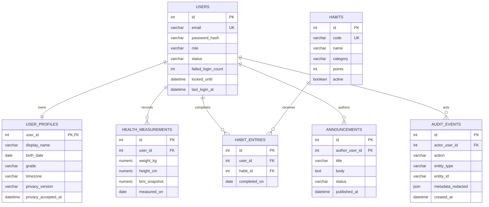

# Modelo de datos y guía DBA

## 1. Decisión

PostgreSQL 18 es el motor de Staging/Production. SQLite se reserva para desarrollo y pruebas. El esquema se gobierna con SQLAlchemy y Alembic; la aplicación nunca crea, elimina ni modifica tablas al arrancar.

## 2. Diagrama vigente



No existe una tabla de saldos ni `daily_checkins`: puntos, nivel y racha se derivan de `habit_entries`. Es una decisión de consistencia, no una omisión.

## 3. Diccionario y retención

| Tabla | Finalidad | Datos clave | Eliminación FK |
|---|---|---|---|
| `users` | Identidad y control de acceso | correo, hash, rol, bloqueo | Raíz |
| `user_profiles` | Presentación y consentimiento | nombre, fecha/grado opcional | CASCADE con usuario |
| `health_measurements` | Historial opcional | peso, altura, IMC, fecha | CASCADE con usuario |
| `habits` | Catálogo controlado | código, puntos, estado | RESTRICT desde entradas |
| `habit_entries` | Evidencia diaria | usuario, hábito, fecha | usuario CASCADE; hábito RESTRICT |
| `announcements` | Comunicación administrativa | autor, contenido, estado | autor RESTRICT |
| `audit_events` | Trazabilidad operativa | actor, acción, entidad | actor SET NULL |

La retención legal/educativa debe aprobarse antes de Production. Técnicamente, la eliminación de una cuenta elimina perfil, medidas y cumplimientos; conserva auditoría sin identificar al actor.

## 4. Integridad

- `users.email`: único, normalizado y no nulo.
- `users.role`: `user|admin`; `status`: `active|inactive`.
- `habit_entries`: `UNIQUE(user_id, habit_id, completed_on)`.
- Peso: 20–500 kg; altura: 80–250 cm; IMC snapshot: 5–100.
- Puntos de hábito: 1–100.
- Estado de comunicado: `draft|published|archived`.
- Todas las FK tienen conducta de borrado explícita.

## 5. Índices

- Correo y código de hábito únicos.
- Historial por `habit_entries(user_id, completed_on)`.
- Búsqueda de hábito por FK.
- Medidas por `health_measurements(user_id, measured_on)`.
- Comunicados por autor y `(status, published_at)`.
- Auditoría por actor, acción y fecha.

Los índices responden a rutas existentes; en Production se revisarán con `EXPLAIN ANALYZE` antes de agregar otros.

## 6. Migraciones

| Revisión | Objetivo | Estado local |
|---|---|---|
| `0380d5595f5e` | Esquema profesional inicial | ✅ aplicada |
| `208469fd48ef` | Índices de FK y rutas de consulta | ✅ aplicada |

`flask db check` no detectó deriva. El downgrade existe, pero una reversión destructiva en Production nunca se ejecuta sin backup, análisis de compatibilidad y aprobación.

## 7. Migración desde el prototipo

No se ha copiado la base SQLite histórica. El proceso seguro sería:

1. Congelar escritura y tomar exportación con hash.
2. Inventariar filas, correos duplicados y calidad sin registrar datos personales.
3. Aplicar migraciones a PostgreSQL aislado.
4. Normalizar identidades; nunca trasladar contraseñas legibles como hash falso.
5. Forzar restablecimiento de acceso si el origen no tiene hashes verificables.
6. Transformar perfil, medidas y eventos.
7. Comparar conteos y huérfanos.
8. Ejecutar pruebas y aprobación antes de cambiar tráfico.

## 8. Backup y restauración

Para una base PostgreSQL con credenciales inyectadas:

```text
pg_dump --format=custom --no-owner --file=vitalilab.dump DATABASE_URL
createdb vitalilab_restore_test
pg_restore --clean --if-exists --no-owner --dbname=RESTORE_URL vitalilab.dump
```

El archivo se guarda cifrado fuera de Git. Se verifican migración actual, conteos por tabla, duplicados diarios, FK y acceso de un usuario ficticio. El plan Free de Render no es aceptable para persistencia de Production; la base gratuita de Staging es temporal y expira según condiciones del proveedor.

## 9. Consultas de control

```sql
SELECT lower(trim(email)), count(*)
FROM users GROUP BY lower(trim(email)) HAVING count(*) > 1;

SELECT user_id, habit_id, completed_on, count(*)
FROM habit_entries
GROUP BY user_id, habit_id, completed_on HAVING count(*) > 1;

SELECT he.id FROM habit_entries he
LEFT JOIN users u ON u.id = he.user_id
LEFT JOIN habits h ON h.id = he.habit_id
WHERE u.id IS NULL OR h.id IS NULL;
```

## 10. Estado

Modelo y migraciones: ✅ validados localmente y sobre PostgreSQL 18 en CI. Backup/restauración y datos reales: 🟡/🔴 antes de Production.
