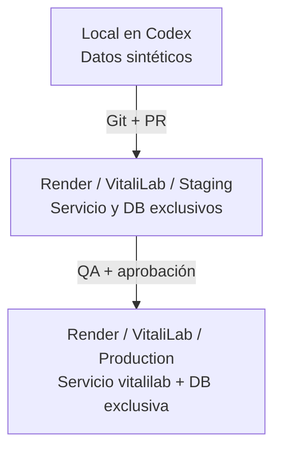
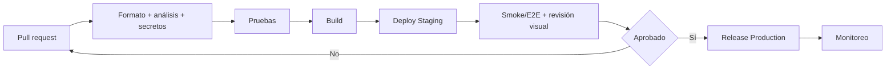

# Infraestructura y despliegue en Render

## 1. Topología



La promoción mueve una versión de código verificada. No comparte bases de datos, secretos ni discos entre ambientes.

## 2. Estado observado al corte

| Elemento | Estado |
|---|---|
| Proyecto Render | ✅ `VitaliLab` |
| Ambiente `Production` | ✅ Contiene el servicio existente `vitalilab` |
| Ambiente `Staging` | ✅ Creado, actualmente vacío |
| Servicio Production | ✅ Conserva nombre y dominio observados |
| Protección avanzada del ambiente | ⚪ No disponible en el plan mostrado; opción Pro |
| Último estado observado | Servicio marcado Live en commit anterior y un despliegue posterior fallido |
| Causa exacta del fallo | ⚪ Pendiente de revisar logs de Render |

Producción no se modifica durante la auditoría sin aprobación explícita.

## 3. Local

Objetivos:

- Ejecutar el proyecto sin depender de Production.
- Usar datos sintéticos y configuración de desarrollo.
- Ejecutar pruebas y migraciones sobre una base desechable.

Entregables pendientes: instrucciones reproducibles, versión de Python, dependencias mínimas, `.env.example`, y comandos de arranque, prueba, migración y seed.

## 4. Staging

Staging debe crearse desde la rama `staging` del repositorio privado y usar recursos propios:

- Servicio web distinto, por ejemplo `vitalilab-staging`.
- PostgreSQL de Staging.
- Variables y secretos exclusivos.
- URL temporal de Render antes de un dominio propio.
- Datos ficticios.
- `debug` desactivado y health check configurado.

No se mueve el servicio de Production a Staging. Se crea uno nuevo cuando exista un baseline seguro y reproducible.

## 5. Production

- Mantener servicio, dominio y variables actuales mientras se audita.
- No conectar Production a ramas de desarrollo.
- Promover solo una versión validada en Staging.
- Tomar backup y comprobar rollback antes de migraciones.
- Mantener secretos separados.
- Registrar quién aprueba y cuándo se despliega.

## 6. Variables de entorno

Inventario por nombre, nunca por valor:

| Variable | Propósito | Local | Staging | Production |
|---|---|---:|---:|---:|
| `APP_ENV` | Selección de configuración | ✅ | ✅ | ✅ |
| `SECRET_KEY` | Firma de sesión | propia | propia | propia |
| `DATABASE_URL` | Conexión de datos | propia | propia | propia |
| `LOG_LEVEL` | Nivel de registro | ✅ | ✅ | ✅ |
| `SESSION_COOKIE_SECURE` | Cookie solo HTTPS | Según local | `true` | `true` |

Cualquier integración futura añade solo nombre, propietario y política de rotación.

## 7. Construcción y arranque propuestos

La configuración final dependerá del backend refactorizado. El objetivo es contar con comandos equivalentes y reproducibles:

```text
Build: instalar dependencias controladas y ejecutar validaciones necesarias
Start: gunicorn "wsgi:app"
Health check: /health
```

Las migraciones se ejecutan en un paso controlado, con backup y registro; no de forma insegura en cada proceso web.

## 8. Pipeline de entrega



## 9. Health checks y smoke tests

Después de cada despliegue:

1. `/health` responde correctamente.
2. Inicio carga por HTTPS.
3. Registro o login de prueba funciona.
4. Dashboard autorizado carga.
5. Un hábito se completa una vez y el reintento no duplica puntos.
6. Logout invalida la sesión.
7. Logs no muestran excepciones ni datos sensibles.

## 10. Logs, métricas y alertas

- Logs estructurados con fecha, nivel, ambiente, ruta, duración e ID de correlación.
- Sin credenciales, tokens ni medidas de salud.
- Seguimiento de respuestas 5xx, latencia, reinicios y fallos de conexión.
- Alerta por despliegue fallido y errores sostenidos.
- Registro de migración aplicada y versión desplegada.

## 11. Rollback

Antes de una release se registra el commit estable anterior, compatibilidad de migración, backup, responsable y criterio de reversión.

Pasos conceptuales:

1. Detener promociones.
2. Revertir a la versión estable si el esquema es compatible.
3. Restaurar datos solo si el análisis lo requiere.
4. Verificar health y recorrido crítico.
5. Documentar incidente y corrección.

## 12. Dominio y TLS

- Conservar `www.vitalilab.space` en Production mientras se audita.
- No apuntar el dominio a Staging.
- Verificar HTTPS y renovación automática.
- Documentar DNS sin publicar credenciales.

## 13. Checklist de promoción

- [ ] PR aprobado y commit identificado.
- [ ] CI en verde.
- [ ] Migración probada.
- [ ] Backup y rollback listos.
- [ ] Variables completas y separadas.
- [ ] Staging aprobado funcional y visualmente.
- [ ] Seguridad sin bloqueantes.
- [ ] Responsable definido.
- [ ] Smoke tests ejecutados.
- [ ] Bitácora actualizada.

## 14. Estado

La separación organizativa Production/Staging está **✅ creada**. El servicio, la base y el pipeline de Staging están **🟡 pendientes**. Production no ha sido modificado por esta documentación.
