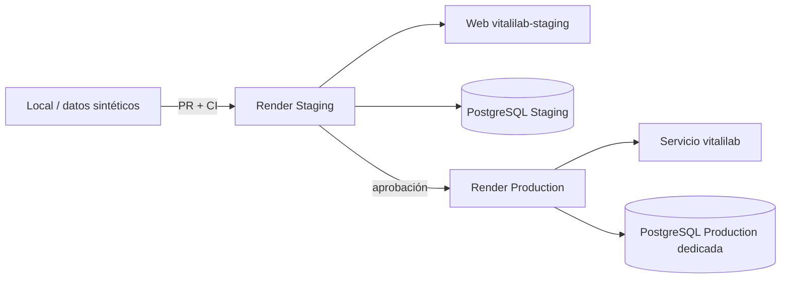

# Infraestructura y despliegue en Render

La copia académica vigente se publica en NexoStack: consulte [publicación](16_PUBLICACION_DE_LA_COPIA_DE_PRACTICA.md) y [operación](18_NEXOSTACK_OPERACION_Y_ACCESOS.md). Este capítulo conserva el montaje Render como alternativa y el estado histórico sin cambios de producción. Para aprender desde cero, consulte [el manual formativo](15_MANUAL_DE_APRENDIZAJE_Y_SUSTENTACION.md).

## 1. Topología



No se comparte DB, secreto ni dominio entre ambientes.

## 2. Configuración versionada

- `.python-version`: Python 3.13.
- `Dockerfile`: usuario no root, Gunicorn y health check `/ready`.
- `compose.yaml`: web + PostgreSQL 18, DB no publicada y health checks.
- `render.yaml`: proyecto `VitaliLab`, ambiente `Staging`, web `vitalilab-staging`, DB exclusiva y auto-deploy después de checks.
- `.github/workflows/ci.yml`: calidad, migración PostgreSQL y build Docker.

## 3. Render Staging

El Blueprint usa rama `staging`, plan web Free y PostgreSQL Free como ambiente temporal. La base queda sin acceso público (`ipAllowList: []`). `SECRET_KEY` se genera y las credenciales SMTP requieren carga manual en el panel.

Estado confirmado el 13 de octubre de 2026: PostgreSQL `vitalilab-staging-db` disponible, acceso externo cerrado y CLI autenticado; ningún servicio web de Staging. Render rechazó el acceso al repo privado. La credencial Git conectada es `ega1026`, distinta del propietario `juandigira17111980`. No debe reemplazarse la conexión histórica sin analizar su impacto.

Inicio de Staging:

```text
flask db upgrade && flask seed-habits && gunicorn ...
```

La migración se ejecuta en el arranque porque el pre-deploy command no está disponible en web Free. En una instancia pagada debe moverse a `preDeployCommand` para separar cambio de esquema y proceso web.

## 4. Advertencia de persistencia

El filesystem del servicio Render es efímero; no se usa SQLite compartido. PostgreSQL Free sirve para demostración temporal y puede expirar a los 30 días según el plan vigente. Production debe usar una base persistente pagada con backups y retención definidos.

La instancia gratuita concreta vence el 31 de octubre de 2026 a las 21:36 de Colombia. Render Free bloquea salida a puertos SMTP 25, 465 y 587; los valores `MAIL_*` no bastan para enviar desde ese plan. La entrega real requiere alojamiento/envío compatibles o una integración por API implementada y probada. [Restricciones oficiales](https://render.com/docs/free).

## 5. Variables

| Variable | Staging | Production |
|---|---|---|
| `APP_ENV` | `staging` | `production` |
| `APP_VERSION` | versión/commit | release |
| `SECRET_KEY` | generada, exclusiva | generada, exclusiva |
| `DATABASE_URL` | DB Staging privada | DB Production privada |
| `SESSION_COOKIE_SECURE` | `true` | `true` |
| `RATELIMIT_STORAGE_URI` | memoria, un worker | Redis si escala |
| `MAIL_*` | secretos Staging | secretos Production |
| `LOG_LEVEL` | `INFO` | `INFO`/política |

## 6. Procedimiento de Staging

1. Fusionar el PR a `staging` solo con CI verde.
2. En Render, crear Blueprint desde el repositorio privado y `render.yaml`.
3. Confirmar que se crean recursos dentro de `VitaliLab / Staging`, no Production.
4. Completar variables SMTP si se probará recuperación real.
5. Esperar build, migración, seed y health check.
6. Ejecutar `/health`, `/ready` y recorrido de aceptación.
7. Registrar URL, commit, hora y resultado en la bitácora.

## 7. Rollback

Staging: seleccionar el último deploy saludable o desplegar el commit anterior. Si la migración no es compatible, restaurar una copia aislada y analizar antes de cambiar datos.

Production: backup verificado, etiqueta de release y commit anterior antes de iniciar. El rollback de código solo es seguro si el esquema conserva compatibilidad hacia atrás.

## 8. Smoke tests

- `/health` 200 y versión correcta.
- `/ready` 200 y DB accesible.
- Inicio HTTPS y cabeceras.
- Registro ficticio, login, perfil, hábito, no duplicación y logout.
- Admin crea/publica comunicado.
- Recuperación real si SMTP está configurado.
- Logs sin 5xx ni datos sensibles.

## 9. Production

Production conserva servicio, dominio, base y variables históricas. Este trabajo no la modifica. La migración desde SQLite/datos originales requiere ventana, inventario, restablecimiento de contraseñas si aplica, backup, ensayo y aprobación.

## 10. Referencias operativas

- [Render: Flask](https://render.com/docs/deploy-flask)
- [Render: health checks](https://render.com/docs/health-checks)
- [Render: Blueprints](https://render.com/docs/blueprint-spec)
- [Render: PostgreSQL](https://render.com/docs/postgresql)

## 11. Estado

Infraestructura como código y CI (PostgreSQL/Docker): ✅. Render Staging y backup: 🟡. Production: 🔴 congelada.
