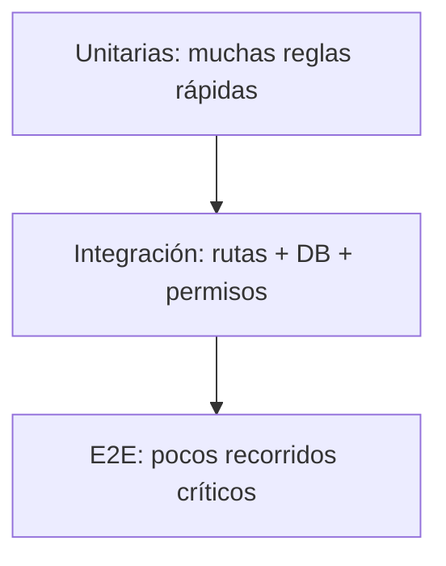

# Estrategia de QA y pruebas

## 1. Objetivo

Demostrar de manera repetible que VitaliLab funciona, protege los datos y puede desplegarse sin degradar Production. Las pruebas son evidencia técnica, no una actividad final opcional.

## 2. Pirámide de pruebas

También se realizan pruebas visuales, accesibilidad, seguridad, migración, rendimiento básico y recuperación.

## 3. Ambientes y datos

- Unitarias: sin servicios externos y con datos fabricados.
- Integración: base temporal creada por migraciones.
- E2E: Staging con usuarios ficticios y reiniciables.
- Production: solo smoke tests no destructivos y aprobados.

Nunca se usan credenciales reales en fixtures ni se copia información personal a reportes.

## 4. Matriz funcional inicial

| ID | Escenario | Resultado esperado | Tipo | Prioridad |
|---|---|---|---|---|
| AUTH-01 | Registro válido | Cuenta y perfil mínimo creados | Integración | Crítica |
| AUTH-02 | Correo repetido | Rechazo controlado, sin duplicado | Integración | Alta |
| AUTH-03 | Contraseña incorrecta | No inicia sesión, mensaje genérico | Integración | Crítica |
| AUTH-04 | Logout | Sesión deja de servir | E2E | Alta |
| SEC-01 | POST sin CSRF | Solicitud rechazada | Integración | Crítica |
| SEC-02 | Editar perfil ajeno | Respuesta 403, sin cambios | Integración | Crítica |
| HAB-01 | Completar hábito | Crea cumplimiento y puntos correctos | Integración | Crítica |
| HAB-02 | Repetir mismo día | No duplica cumplimiento ni puntos | Integración/concurrencia | Crítica |
| HAB-03 | Días consecutivos | Racha aumenta según regla | Unitaria | Alta |
| HAB-04 | Día omitido | Racha se reinicia según regla | Unitaria | Alta |
| UX-01 | Flujo a 360 px | Sin corte ni desplazamiento horizontal | Visual | Alta |
| A11Y-01 | Registro por teclado | Orden, foco y errores accesibles | Manual/automatizada | Alta |
| DBA-01 | Migración en DB vacía | Esquema completo y consistente | Integración | Crítica |
| DBA-02 | Restauración | Conteos y relaciones coinciden | Operativa | Crítica |
| OPS-01 | Health check | Respuesta saludable | Smoke | Crítica |
| OPS-02 | Rollback ensayado | Vuelve a versión estable | Operativa | Crítica |

## 5. Compatibilidad backend/frontend

Para evitar la divergencia observada entre rutas y plantillas:

- Toda llamada a `url_for` resuelve en una prueba de renderizado.
- Cada plantilla declara las variables que espera.
- Las rutas se recorren como anónimo, usuario y administrador.
- Se prueban estados con datos, vacío, validación fallida y permiso denegado.

## 6. Pruebas de base de datos

- Migraciones desde cero y desde el baseline elegido.
- Restricciones únicas y claves foráneas.
- Transacción atómica de hábito/puntos/racha.
- Consultas principales con plan razonable.
- Backup y restauración aislada.
- Ausencia de contraseñas legibles y registros huérfanos.

## 7. Seguridad

- Autenticación y autorización horizontal/vertical.
- CSRF, XSS e inyección.
- Rate limiting en endpoints sensibles.
- Cookies y cabeceras.
- Escaneo de secretos y dependencias.
- Manejo de errores sin trazas públicas.

Una herramienta automática no reemplaza el análisis de reglas de negocio.

## 8. UX, responsive y accesibilidad

Registrar navegador, sistema, resolución, fecha y resultado para:

- Inicio → registro.
- Login → dashboard.
- Completar hábito → observar progreso.
- Editar perfil con errores y éxito.
- Administración con y sin permiso.

Verificar teclado, lector de pantalla en flujos críticos, contraste, zoom 200 %, orientación y mensajes.

## 9. Rendimiento básico

Medir en Staging con volumen documentado:

- Respuesta de inicio, login y dashboard.
- Consultas por pantalla y consultas lentas.
- LCP, CLS e INP.
- Solicitudes concurrentes de cumplimiento.
- Tiempo de arranque y consumo del servicio.

No se prometen números sin línea base; los presupuestos se acuerdan tras medir.

## 10. Gestión de defectos

| Severidad | Definición | Salida |
|---|---|---|
| Bloqueante | Pérdida de datos, acceso indebido o app no inicia | Impide promoción |
| Alta | Flujo principal incorrecto o riesgo significativo | Corregir antes de release |
| Media | Alternativa disponible, impacto acotado | Planificar con responsable |
| Baja | Mejora visual/documental menor | Puede quedar en backlog |

Todo defecto registra pasos, resultado esperado/real, ambiente, versión y evidencia sin datos sensibles.

## 11. Reporte de ejecución

| Campo | Valor a registrar |
|---|---|
| Versión/commit | Identificador exacto |
| Ambiente | Local o Staging |
| Fecha y responsable | Trazabilidad |
| Pruebas ejecutadas | IDs o suite |
| Aprobadas/fallidas/omitidas | Conteos |
| Defectos abiertos | Severidad y enlace |
| Evidencia | Log redactado, captura o reporte |
| Decisión | Aprobado/rechazado con motivo |

## 12. Criterio de salida a Production

- Cero defectos bloqueantes o críticos abiertos.
- Pruebas críticas aprobadas.
- Seguridad revisada.
- Migración y restauración ensayadas.
- Recorrido visual y accesible aprobado.
- Rollback disponible.
- Documentación y bitácora al día.
- Aprobación explícita del responsable.

## 13. Estado

La estrategia está **✅ documentada**, pero las suites y resultados están **🟡 pendientes** porque la implementación funcional aún no se ha iniciado.
