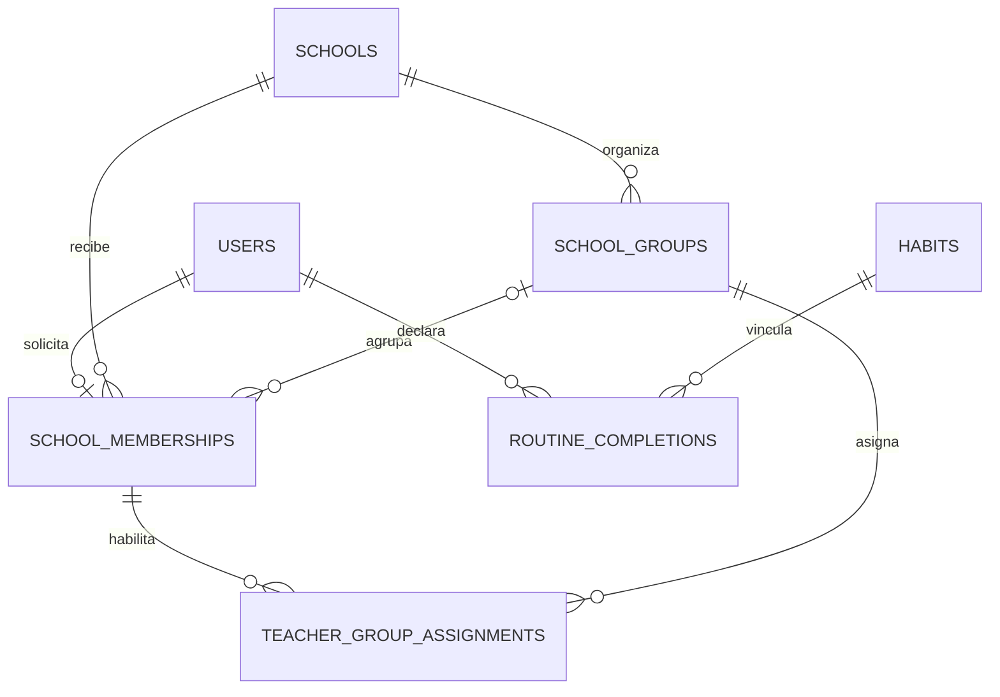

# Guía de aprendizaje: VitaliLab personal y escolar

Edición: 14 de octubre de 2026, Colombia. Complementa el [manual desde cero](15_MANUAL_DE_APRENDIZAJE_Y_SUSTENTACION.md). Explica el módulo implementado, no un convenio con colegios ni una aprobación clínica. Para preparar una sustentación utiliza exclusivamente personas y mediciones ficticias.

## 1. Qué cambió y por qué

Antes, «Institucional» era una preferencia del formulario y el colegio era texto libre. Escribir «docente» o el nombre de un colegio no prueba quién eres. Ahora se separan tres conceptos:

| Concepto | Ejemplo | Qué permite |
|---|---|---|
| Enfoque del perfil | Personal o institucional | Personalizar la experiencia; no concede privilegios |
| Vinculación | Colegio, grupo, rol solicitado, estado y revisión | Acreditar un acceso escolar después de verificación humana |
| Asignación docente | Docente aprobado → grupo del mismo colegio | Consultar únicamente el reporte agregado de ese grupo |

Una cuenta tiene una vinculación institucional en esta edición. Un docente puede tener varios grupos del mismo colegio. No se implementan facturación SaaS, SSO escolar ni gestión independiente por administradores de cada colegio: la administración escolar es global y de confianza.

Se mantienen ocho hábitos, metas, bitácora, puntos y rutinas. El catálogo pasa de seis a nueve rutinas. Se incorporan seguimiento anual propio y «Tu próximo paso» con objetivo funcional elegido, no prescrito por IMC.

## 2. Montaje local desde cero

1. Sigue el capítulo 4 del manual para instalar Python 3.13, crear el entorno e instalar dependencias.
2. Configura una base SQLite de práctica y las variables locales en la misma terminal. Nunca copies credenciales del VPS a tu computador de aprendizaje.
3. Ejecuta estas órdenes desde la raíz del repositorio:

```powershell
.\.venv\Scripts\python.exe -m flask --app wsgi:app db upgrade
.\.venv\Scripts\python.exe -m flask --app wsgi:app seed-habits
.\.venv\Scripts\python.exe -m flask --app wsgi:app seed-schools
.\.venv\Scripts\python.exe -m flask --app wsgi:app db current
.\.venv\Scripts\python.exe -m flask --app wsgi:app db check
.\.venv\Scripts\python.exe -m flask --app wsgi:app create-admin
.\.venv\Scripts\python.exe -m flask --app wsgi:app run
```

La revisión esperada es `a903b5d7e214`. Los seeds se pueden repetir: el de colegios crea solo opciones ausentes y no reactiva colegios pausados. `create-admin` solicita datos de forma interactiva; úsalo solo en tu base local. Una cuenta pública nunca puede marcarse administradora.

El catálogo inicial incluye I.E. José Miguel de la Calle y Leticia Arango por solicitud del propietario. No se crean grupos, docentes aprobados ni alumnos reales automáticamente. La presencia de un nombre no demuestra convenio o autorización institucional.

## 3. Preparar la demostración como administrador

1. Ingresa con tu cuenta administrativa y abre **Mi cuenta → Administración → Administración escolar** (`/admin/colegios/`).
2. Revisa el catálogo. Si necesitas otro colegio de práctica, crea nombre e identificador, por ejemplo `colegio-demostracion`.
3. En «Nuevo grupo», selecciona colegio, nombre y año: `Grupo ficticio A`, `2026`. El año distingue cohortes; no reutilices el mismo grupo para cursos de años distintos.
4. Pide a cada cuenta ficticia que solicite su vinculación; no compartas sesiones ni contraseñas.
5. En «Vinculaciones», abre «Revisar». Comprueba identidad y autorizaciones por el procedimiento externo del responsable. En la demostración, verifica que sean datos ficticios.
6. Elige aprobar y confirma la verificación. Un estudiante necesita grupo activo del mismo colegio. Para un docente, la aprobación no asigna grupos por sí sola.
7. En «Asignar un docente», selecciona docente aprobado y grupo de su colegio. El servidor y la base rechazan cruces entre colegios.
8. Para retirar acceso, revoca la vinculación, retira la asignación o pausa el colegio/grupo. Los permisos se vuelven a comprobar en cada petición.

La casilla de revisión registra una declaración administrativa, su responsable y fecha. No valida automáticamente documentos ni sustituye consentimiento del representante. No apruebes alumnado real en este laboratorio.

## 4. Recorrido personal, paso a paso

1. Crea una cuenta eligiendo **Personal**. Se abre Hoy.
2. Registra un hábito y comprueba tus puntos. Repetir el mismo hábito hoy no debe duplicarlos.
3. En **Mi cuenta → Mi perfil**, elige postura y centro, energía cotidiana o fuerza de base. Guarda.
4. Peso, altura, fecha de nacimiento y referencia de crecimiento son opcionales. Puedes usar la plataforma sin ellos.
5. Bajo la última medición aparece «Tu próximo paso», aun si no has compartido medidas. Lee las instrucciones y adapta o detén la actividad si resulta incómoda.
6. Abre el temporizador: comenzar, pausar, continuar y reiniciar son controles locales, no una comprobación de ejercicio físico.
7. Después de realizarla, pulsa **Registrar en mi día**. El botón pasa a «Registrada hoy». Es una declaración del usuario.

Las tres tarjetas nuevas aportan el hábito «Movimiento a tu ritmo»: 15 XP una sola vez al día. Si ya marcaste ese hábito o completas otra rutina asociada al mismo hábito, se guarda la rutina sin sumar otra vez esos puntos. Se premia participación, no cambio corporal.

## 5. Recorrido estudiantil

1. En registro elige **Institucional**. Tras crear la cuenta, un segundo paso abre `/colegios/` para seleccionar colegio, grupo disponible y rol Estudiante.
2. Una cuenta existente puede entrar por **Mi cuenta → Mi colegio**. La solicitud cambia el enfoque a institucional, pero queda pendiente.
3. Espera la revisión del administrador. No se habilitan reportes docentes por solicitar un rol.
4. Si procede en una práctica ficticia, guarda una medición opcional en Mi perfil.
5. Abre **Mi seguimiento físico** (`/perfil/seguimiento`), elige el año y consulta la gráfica y su tabla equivalente. Solo ves tus propios registros.
6. Después de aprobar tu vinculación, puedes activar voluntariamente el aporte a estadísticas desde Mi colegio. Está apagado por defecto. Solo se consideran registros posteriores a la aprobación y a esa activación.
7. Desactivarlo interrumpe el aporte inmediatamente. Retirar la vinculación también lo detiene. No borra tu historial personal. Cambiar a Personal excluye tu cuenta de reportes sin borrar la vinculación.

No deben exigirse medidas o aporte a estadísticas como condición para participar en hábitos, recibir puntos o ser evaluado académicamente.

## 6. Recorrido docente

1. Solicita rol Docente. Seleccionarlo no entrega permisos.
2. Después de revisión y asignación de grupos, aparece **Mi cuenta → Panel docente** (`/docentes/`). Mantén el enfoque institucional.
3. «Mis grupos» muestra únicamente asignaciones vigentes del mismo colegio.
4. «Ver reporte del grupo» ofrece meses fijos del año escolar, sin nombres, correos, peso, altura ni mediciones individuales.
5. El reporte exige diez estudiantes elegibles que aporten voluntariamente. Cada indicador mensual exige también diez participantes distintos. Si faltan, aparece «No disponible»; no se revela el número pequeño.
6. Los conteos se redondean hacia abajo a múltiplos de cinco. El promedio del percentil se redondea a cinco puntos. No es diagnóstico, calificación ni objetivo del grupo.
7. En las herramientas de clase, revisa una rutina y abre «Proyectar en clase». La vista muestra instrucciones y temporizador sin nombres ni puntos. El responsable debe valorar edad, capacidad y adecuación; no hay validación clínica automática.

No se añaden filtros por sexo, edad o estudiante ni exportaciones individuales. La supresión y el redondeo reducen identificación, pero no garantizan anonimato absoluto: cambios de composición o conocimiento externo aún pueden generar inferencias. No publiques capturas ni uses reportes para comparar cuerpos.

## 7. Entender el IMC sin convertirlo en diagnóstico

IMC = peso en kilogramos / (altura en metros × altura en metros). Por ejemplo, 45 kg y 1,50 m producen 20. El número solo no determina salud, capacidad ni ejercicio adecuado.

Para crecimiento se usa la referencia **OMS 2007**, en meses completos al día de la medición y con referencia femenina o masculina opcional. No se deduce de nombres ni representa identidad de género. El cálculo se hace localmente: no se envían medidas a la OMS.

El archivo `app/data/who_bmi_2007.csv` contiene 336 filas LMS oficiales: 168 meses por referencia, de 61 a 228 meses. Los parámetros L, M y S transforman el IMC en un valor estandarizado y luego en percentil. Un percentil no es una nota sobre 100 ni un porcentaje de salud. Se describe la posición frente a una referencia de crecimiento, no un objetivo.

El sistema evita extrapolar fuera del intervalo central z entre −3 y 3. Si falta edad/referencia, la edad está fuera de la tabla o el resultado exige extrapolación, no calcula percentil ni sustituye por rangos adultos. Las mediciones anteriores no se reinterpretan retroactivamente: cada nueva medición guarda edad, referencia, fuente y percentil cuando procede.

Consulta [fuentes y límites del archivo](../app/data/README.md). La referencia poblacional y el software no equivalen a validación médica individual. Los ejercicios elegidos por IMC y etiquetas como «sobrepeso», «obesidad» o «bajo peso» se excluyen de esta experiencia.

## 8. Base de datos: de nueve a catorce entidades

Una entidad guarda un concepto con identidad propia. Separarlas evita repetir colegios en miles de perfiles y confundir solicitud con permiso. Las cinco nuevas tablas son:

| Tabla | Responsabilidad | Regla principal |
|---|---|---|
| `schools` | Catálogo y estado | Código único |
| `school_groups` | Grupo y año de un colegio | Colegio/año/nombre únicos |
| `school_memberships` | Vinculación, solicitud, revisión y aporte | Una por usuario; grupo del mismo colegio |
| `teacher_group_assignments` | Docente vinculado a grupos | Misma institución; asignación única |
| `routine_completions` | Rutina declarada por persona y día | Usuario/rutina/día únicos |



`user_profiles` añade objetivo y referencia opcional. `health_measurements` añade el contexto de referencia calculado. Una FK compuesta es una clave que comprueba dos columnas juntas: impide que grupo y colegio se contradigan, incluso si se intenta insertar fuera del formulario. La condición «docente aprobado» también se verifica en el servidor; una FK no entiende todas las reglas de permisos.

La revisión `a903b5d7e214` es la quinta. Crea cinco tablas y añade columnas sin borrar cuentas, hábitos ni medidas. Conserva los antiguos textos libres, pero nunca los transforma en membresías aprobadas. Se amplían límites técnicos de peso/altura para no imponer un mínimo adulto; son controles de plausibilidad, no rangos saludables.

## 9. Código y recorrido de una acción

| Capa | Archivos | Qué estudiar |
|---|---|---|
| Modelos | `app/models.py` | Tablas, FK, CHECK y UNIQUE |
| Transición de esquema | `migrations/versions/a903b5d7e214_school_wellness.py` | Upgrade aditivo y orden de dependencias |
| Reglas escolares | `app/services/school.py` | Aprobación, alcance por grupo, supresión y consentimiento |
| Rutas y formularios | `app/school/` | Sesión, CSRF, validación y respuestas |
| Crecimiento | `app/services/measurements.py`, `app/data/` | Edad al medir, LMS, gráfico propio |
| Rutinas y puntos | `app/services/movement.py`, `app/wellness/catalog.py` | Objetivo funcional y transacción idempotente |
| Interfaz | `app/templates/school/`, `profile/`, `app/static/css/school.css` | Estados, tablas contenidas, móvil |
| Pruebas | `tests/test_school.py`, `tests/test_measurements_movement.py`, `tests/test_auth.py` | Casos permitidos y denegados |
| PostgreSQL real | `scripts/verify_postgres_release.py` | FK cruzadas y dos registros concurrentes |

Ejemplo para sustentar: el usuario pulsa «Registrar en mi día» → el navegador envía POST con CSRF → la ruta usa la identidad de la sesión, no un ID suministrado → el servicio intenta insertar una rutina única por día → intenta registrar su hábito único → la transacción confirma ambas operaciones y la auditoría. Dos peticiones simultáneas encuentran la restricción de base y solo una gana los puntos. No hay un contador XP independiente que pueda sumarse dos veces.

## 10. Git, infraestructura y reversión

El cambio se prepara en `feat/school-wellness-platform`, se revisa por PR a `staging`, y debe superar calidad, PostgreSQL y contenedor. `main` y el Render histórico no se promocionan.

NexoStack utiliza exclusivamente `/opt/labs/vitalilab`, Compose `vitalilab-lab`, web y PostgreSQL dedicadas, volumen propio y credenciales fuera de Git. La web tiene DML sobre las catorce entidades, no permisos de crear tablas ni administrar otros proyectos.

El despliegue instala una versión identificada por commit, valida Compose, construye, prepara su base, hace backup previo, migra, ejecuta seeds y `db check`, concede permisos a tablas nuevas y activa solo esta web. Se comprueban `/health`, `/ready`, acceso y versión. No se reinicia Traefik ni se tocan Mercanta, Murano o Krono 57.

Rollback: volver al código/imagen previa conservando el esquema aditivo. **No ejecutar `downgrade` sobre la base compartida**: borraría tablas o columnas y podría rechazar medidas nuevas al estrechar límites. Un dump se restaura primero en otra base; nunca se sobreescribe el volumen activo como ensayo.

## 11. Informe QA y límites del dictamen

Alcance: monolito Flask, catorce entidades, rutas autenticadas, interfaz y despliegue aislado del laboratorio. No es auditoría legal, certificación WCAG, pentest externo ni evaluación clínica.

| Riesgo | Control / evidencia | Riesgo residual |
|---|---|---|
| Autoasignarse docente/admin | Registro ignora rol global; vinculación pendiente; prueba de escalamiento | Verificación humana debe ser genuina |
| Consultar otro colegio | Comprobación por petición y FK compuestas; prueba PostgreSQL | Admin global sigue siendo de alta confianza |
| Exponer grupos pequeños | Umbral diez por indicador/mes y redondeo; pruebas de supresión | No hay anonimato matemático ni privacidad diferencial |
| Capturar historial anterior al aporte | Filtro por fecha del registro y creación, aprobación y activación | Capturas previas no se pueden recuperar |
| Duplicar XP | UNIQUE, savepoints y prueba concurrente PostgreSQL | La realización física es autodeclarada |
| Interpretar menores como adultos | Referencia OMS y límites explícitos; pruebas por edad/faltantes/extremos | No hay validación clínica del producto |
| Dañar otros proyectos | Compose/volumen/rutas propios, backup y comparación de contenedores | Infraestructura física y proxy compartidos |

Las verificaciones locales incluyen suite completa, cobertura, Ruff, Bandit y navegación real móvil/escritorio. CI debe confirmar PostgreSQL, restauración de las catorce tablas, ausencia de deriva y construcción. El resultado de publicación se registra con commit, PR, ejecución CI y salud remota; no se confunde un diseño con una publicación.

Evidencia local de este corte: **91 pruebas aprobadas; 94,83 % de cobertura**, sin hallazgos en Ruff/Bandit de severidad configurada. Navegador Chromium a **320, 390 y 1440 px** para perfil, seguimiento, colegio, panel/reporte/proyección docente y administración: sin desbordamiento horizontal de página; tablas anchas contenidas con desplazamiento. Registro de rutina y reinicio del temporizador comprobados. Se corrigió una declaración CSS de grilla durante esta revisión. Esto no sustituye una evaluación formal de accesibilidad o revisión clínica. Advertencias de deprecación de Flask-Login/Alembic quedan como deuda técnica no bloqueante del piloto.

Evidencia remota previa a integración: [PR #10](https://github.com/juandigira17111980/vitalilab-profesional/pull/10), [CI 38677390624](https://github.com/juandigira17111980/vitalilab-profesional/actions/runs/38677390624), commit funcional `1c79883956451313d71e40d7ca183f4f825b1ed8`: tres trabajos aprobados, 91 pruebas/94,83 %, auditoría de dependencias sin vulnerabilidades conocidas, FK compuestas y registro concurrente en PostgreSQL 18, backup/restore con conteos de las catorce entidades y esquema sin deriva. El commit integrado puede diferir por incluir esta evidencia documental; siempre compara `/health` con `staging`, no con el commit de una captura antigua.

**Dictamen:** apto para demostración académica con datos ficticios una vez superadas CI y comprobaciones remotas. **No apto todavía para recopilar datos reales de menores o venderse como producto clínico.** Antes se necesitan responsable de tratamiento y política completa, autorizaciones verificables, procedimiento de derechos/retención, revisión profesional de contenido y cálculos, evaluación de reidentificación y pruebas operativas de escala/offsite. Responsable de esas decisiones: propietario e institución, no la selección de un formulario.

La nueva política visible se identifica como `2026-10-14` para cuentas nuevas. No se reescribe la aceptación histórica de las existentes; el aporte escolar exige su acción explícita independiente. Antes de uso real se debe definir y ejecutar la actualización/reaceptación aplicable, no presumirla.

## 12. Prácticas y preguntas para sustentar

1. Crea tres cuentas ficticias separadas: personal, estudiante y docente. Comprueba que pedir Docente no abre su panel.
2. Crea dos colegios y un grupo por colegio. Intenta asignar el docente al ajeno y explica por qué se rechaza.
3. Aprueba el docente y asigna solo su grupo. Revócalo y verifica que la sesión abierta pierde acceso.
4. Consulta un grupo sin diez aportes: explica por qué no se muestra una estadística de nueve personas.
5. Guarda una medida ficticia sin fecha de nacimiento; explica por qué no aparece un percentil infantil inventado.
6. Elige otro objetivo funcional sin cambiar IMC. Observa que cambia la tarjeta y explica esa separación.
7. Registra la misma rutina dos veces; después otra del mismo hábito. Explica rutina, hábito y XP.
8. Dibuja el recorrido pantalla → ruta → servicio → base → respuesta. Muestra una prueba negativa y una positiva.

Respuesta modelo: «No basta ocultar el botón docente: el servidor comprueba la vinculación y la asignación en cada solicitud, y la base impide colegios cruzados. La interfaz orienta; el backend y las restricciones protegen».
